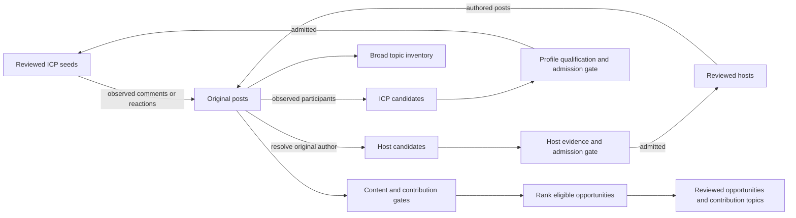

# Topic and audience workflows

This fork ships two independent research skills and two manual draft workflows.

The [decision record](TOPIC-AND-AUDIENCE-DECISIONS.md) captures Philipp's choices,
the first version's architecture and its remaining validation limits.

| Skill | Question it answers | Result |
| --- | --- | --- |
| `/gtmb-topic-analyzer` | Which recurring questions and problems deserve our attention? | Sourced topic shortlist, confidence, proposed angles and reviewed priorities |
| `/gtmb-audience-loop` | Which people and live conversations are relevant to our offering? | Independently assessed ICPs and hosts, timely opportunities and review decisions |

Run either skill directly for one sitting, or start its Topic analysis or Audience discovery
workflow for staged execution. A workflow records progress through the existing workflow tool;
the skill performs only its current stage. All shipped workflows remain manual drafts.

Topic analysis can read customer interviews, CRM notes or supplied material without audience
discovery. Audience discovery can start from strategy and ICP without a topic shortlist.
An optional handoff passes source/report references, profile, scope and unanswered questions.
It never transfers qualification, approvals or automatically starts the other workflow.

## Post-centred discovery process

Philipp's sketch, reviewed on 20 November 2026, defines a shared evidence network with posts
at its centre. The two skills are views over this network: audience discovery assesses people
and conversations; topic analysis interprets the subject matter. They keep independent runs
and can operate alone. Neither automatically starts the other.

### One discovery cycle

1. **Frame and resume.** Select the company profile, research question, source window and
   company-owned configuration. Load reviewed seeds, previous decisions and unresolved request
   state. Candidate seeds may be explored but remain explicitly provisional; tracking membership
   alone never establishes current qualification.
2. **Collect observed edges.** From ICP seeds, retrieve observed comments/reactions and resolve
   their original posts. From host seeds, retrieve authored posts. Preserve canonical IDs,
   authorship, source references, dates and truncation. Keep comment and reaction edges distinct.
3. **Screen the content.** Metadata ranking can prioritize retrieval. Read original text before
   declaring relevance. Preserve missing evidence as needs-screening. Keep the full research
   inventory separate from the content-qualified subset used for expansion and recommendations.
4. **Expand hosts.** Resolve who authored relevant posts. Assess whether relevant, independently
   qualified audience members participate across distinct relevant discussions. One promising
   author is a candidate; recurring authorship alone does not establish a qualified host audience.
5. **Expand ICPs.** Inspect visible participants in relevant conversations. Evaluate current
   organisation fit, buyer role and other profile requirements independently. Participation is
   a discovery signal, not qualification. “Who reads?” means “who visibly engages?” here: silent
   readership, agreement and purchase intent cannot be inferred from these observations.
6. **Analyze two outputs.** Broad topic analysis describes the sampled conversation landscape,
   retaining off-profile subjects and uncertainty. Contribution selection applies the shared
   contract, then ranks passing opportunities and aggregates their topics/hosts. A post excluded
   for commenting can remain valid inventory evidence; it cannot bypass a downstream gate.
7. **Review and admit.** Present host and ICP nominations with separate evidence and admission
   states. Record accepted, held and rejected decisions with their reasons through existing brain
   tools. List changes require the company's admission rule and owning tool. A person can be
   both ICP and host, with independent decisions; a post recommendation admits neither role.
8. **Close the cycle.** Retain sourced findings, decisions and coverage. On the next authorized
   run, use newly admitted people alongside existing seeds and preserve prior exclusions. Resume
   collector requests and workflow steps rather than duplicating them. This describes repeatable
   manual execution, not permission to schedule, spend, publish or contact anyone.

### Shared evidence and gates

Use existing person/entity IDs, sourced memories, reports and collector references. Preserve
person-to-post engagement and author-to-post authorship; attach topic assessments and their
source revisions. Do not create a second identity store or a new topic ontology merely for this
process. Stable post IDs can remain in referenced evidence artifacts until an actual application
adapter establishes their storage contract.

The gates answer different questions: identity/authorship; content relevance; ICP qualification;
host-audience evidence; contribution eligibility; and admission. A pass at one gate does not
transfer to another. Each decision retains its profile, evidence, date, unknowns and reason.
Strict format exclusions belong to the company contribution policy; they are not universal
exclusions from learning about the audience. Expansion has its own content and qualification
requirements and must not promote unrelated social threads simply because many seeds reacted.

### Implementation status and acceptance milestone

As of 20 November 2026:

| Layer | Implemented | Still missing |
| --- | --- | --- |
| Reusable plugin | Two skills, manual workflow templates, shared contribution contract and existing brain storage/workflow tools | Verified execution of the complete network cycle inside a company brain |
| Local research prototypes | Historical engagement graph, recurring-author analysis, bounded host-post topic analysis and gated recommendation/export runner | One connected execution path spanning collection, both expansion branches and reviewed admissions |
| ICP expansion | Content-gated discovery experiment | Demonstrated useful new qualified ICPs; current replay reports none |
| Contribution selection | Source-bound, agent-reviewed assessments consumed by ranking and generic exports | Autonomous semantic review, current-feed freshness and verified application import |
| Feedback into discovery | Rules for per-role decisions and retention | End-to-end proof that a reviewed admission is consumed by the next run without qualification leakage |

The next acceptance milestone is one bounded cycle: known ICP → observed relevant post →
assessed author and participants → separately reviewed host/ICP nominations → authorized
admissions → a subsequent run demonstrably consumes those admissions. An honest zero-result
branch is acceptable; invented qualification is not. Verify provenance, rejected/unknown states,
deduplication and resume behavior, and report whether the cycle improved the relevant network.
This milestone is proposed work, not a claim that the cycle already runs.

## Contribution filtering

Both skills use one [contribution eligibility contract](../plugins/gtm-brain/skills/gtmb-topic-analyzer/references/contribution-filtering.md).
Company settings define format exclusions, profile fit, canonical contribution topics and
freshness. Source-bound semantic review and a concrete contribution precede final ranking;
unknowns remain queued. Recommendations, aggregates and recommendation exports consume the
same eligible set, while broad topic inventories retain separately labelled research evidence.

This ports the validated prototype's decision requirements into reusable skill instructions.
It does not port its executable runner or private configuration, install the fork, or provide
an autonomous semantic classifier. An adapter still requires the contract's adoption checks.

## Existing brains

Setup copies the four workflow templates into a new brain. Upgrade adds them only when the
workflows folder is absent; it never overwrites or replenishes an existing folder. For an
existing brain, ask to create Topic analysis or Audience discovery from the corresponding
shipped template through the normal `gtmb-workflow` creation procedure. Review and save it
there. Installing this fork alone does not activate it or schedule execution.

## Collection and company configuration

Provider access, budgets, geography, freshness, quality targets, tracking lists and delivery
channels belong to the company, not the plugin. Reuse an existing resumable collector and its
request ledger. These skills do not implement a new collector or provide paid research
permission. Without authorized access, analyze supplied evidence and report the source gap.
LinkedIn actions and external delivery retain separate authorization.

The audience method adapts the LinkedIn Agent audience-loop structure into a provider-neutral
skill. Topic analysis implements the agreed integration design; it is not a claimed verbatim
migration of a previously located topic-analyzer skill. No credentials, personal datasets,
Slack channel IDs, standing budgets or dated allowances are shipped.

## Development validation

The skill catalog and workflow tests cover discovery, manual defaults and real parser behavior.
Validate new skills with the skill-creator validator and run the repository suite before shipping.
Live connector behavior, research judgement and installation require separate end-to-end checks.

## Preparation validation on 20 November 2026

Both skill-creator validators and the generated-file consistency check pass. All 69 tests in
the six affected suites pass, including separate workflow continuation, catalog discovery,
name registration, document listing and template defaults. Tests run from a temporary checkout
without spaces because parts of the existing harness use URL pathnames as filesystem paths.

The broader suite has an unrelated date-sensitive failure in `dots.test.mjs`: its expectation
accepts only 10-19 November while the recorded date is 20 November. The broad run was stopped during its 96-version historical upgrade
matrix; full-suite validation is incomplete. Its two change-related failures were corrected
and pass in the final affected-suite rerun. No live provider collection, installation or
semantic end-to-end run has been performed for this preparation.

## Contribution contract validation — 20 November 2026

Both skill validators, relative-link checks, generated-file consistency and diff checks pass.
The three affected catalog/workflow suites ran 44 tests: 43 passed; the continuation fixture
needed the newly required Contribution policy. After updating that fixture, its focused rerun
passed, including refusal to start either workflow without the policy and independent resume
after it is supplied. No runtime collector, classifier or installed plugin was changed.
Full-suite and live semantic validation remain outside this contract update.

Publication check: all 44 tests in the three affected catalog/workflow suites passed together
after the fixture update. Both skill validators, changed Markdown links, generated-file
consistency and diff checks also passed. The full compatibility suite and live benchmarks
were not rerun for this documentation/skill-contract publication; their prior limits remain.
